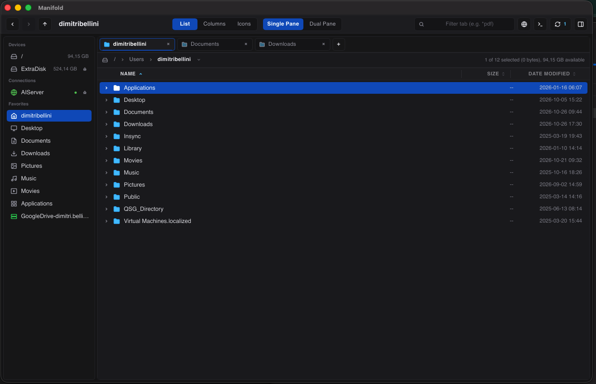
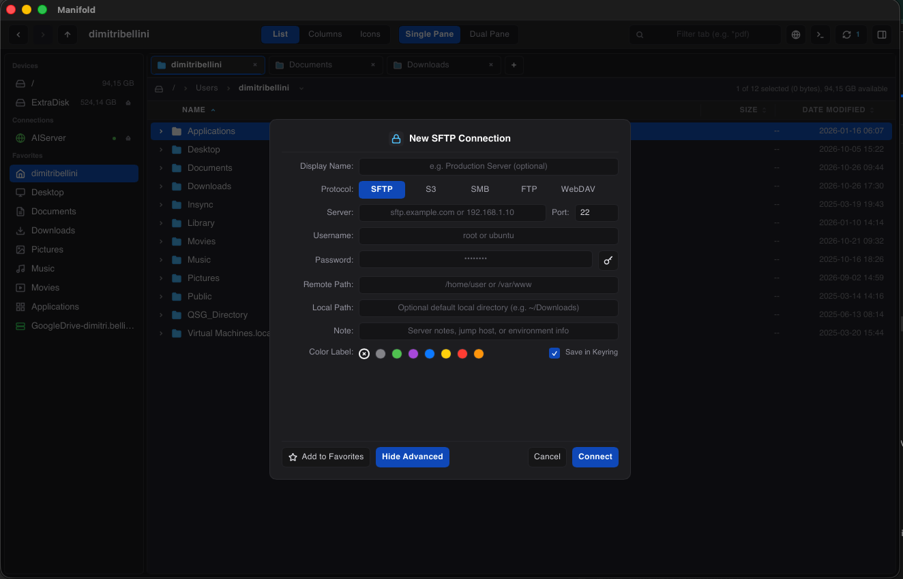

# Manifold

<div align="center">

[](https://github.com/dimitribellini/manifold)
[](https://github.com/dimitribellini/manifold/releases)
[](#quick-start)
[](#architecture)
[](#license)

Cross-platform dual-pane file manager and remote transfer client built in Rust and Slint.

[**Releases**](https://github.com/dimitribellini/manifold/releases) · [**Quick Start**](#quick-start) · [**Features**](#features) · [**Remote Connections**](#remote-connections) · [**Keyboard Shortcuts**](#keyboard-shortcuts) · [**Build from Source**](#build-from-source) · [**Architecture**](#architecture)

</div>

---

<div align="center">
  
</div>

---

## Quick Start

Download the latest release for **macOS (Apple Silicon)**, **Linux (x86_64)**, or **Windows (x86_64)** from [GitHub Releases](https://github.com/dimitribellini/manifold/releases).

### macOS (Apple Silicon / ARM64)
```bash
curl -sSL https://github.com/dimitribellini/manifold/releases/latest/download/manifold-macos-arm64.tar.gz | tar -xz
mv Manifold.app /Applications/
open /Applications/Manifold.app
```

### Linux (x86_64)
```bash
curl -sSL https://github.com/dimitribellini/manifold/releases/latest/download/manifold-linux-x86_64.tar.gz | tar -xz
chmod +x manifold-linux-x86_64
sudo mv manifold-linux-x86_64 /usr/local/bin/manifold
manifold
```

### Windows (x86_64)
```powershell
Invoke-WebRequest -Uri https://github.com/dimitribellini/manifold/releases/latest/download/manifold-windows-x86_64.zip -OutFile manifold-windows-x86_64.zip
Expand-Archive -Path manifold-windows-x86_64.zip -DestinationPath .
.\Manifold.exe
```

---

## Features

- **Single & Dual-Pane Workspace**: Switch between Single Pane and Dual Pane with resizable splitters for the sidebar, panes, table columns, inspector drawer, and bottom terminal.
- **Folder Tabs & Breadcrumb Navigation**: Manage multiple tabs per pane with drag-and-drop tab reordering, clickable breadcrumb paths, and `Cmd/Ctrl + L` path editing with `Tab` completion.
- **Three View Modes (`List`, `Columns`, `Icons`)**: Browse files in a sortable details table, Miller columns with a live preview column, or an icon grid with inline image thumbnails.
- **File Previews & Media Metadata**: Inspect image, audio, video, text, source code, and document metadata in the right-hand Inspector drawer (`Cmd/Ctrl + I`), on hover, or via the Quick Look viewer (`Space`).
- **Background Transfers & Conflict Resolution**: Run local and remote file transfers on background threads with progress tracking and pre-flight conflict resolution (`Replace`, `Replace Older`, `Keep Both`, `Skip`, `Stop`, and `Apply to all`).
- **Integrated Terminal**: Open an embedded PTY shell (`>_`) that stays synchronized with the active pane's working directory and supports command history and `Ctrl+C` interrupts.
- **Fast Search & Keyboard Navigation**: Filter directories per tab with wildcard queries (`*`, `?`) and navigate using arrow keys, shortcuts, or drag-and-drop across panes, tabs, and sidebar targets.
- **Archives, Sync & Batch Tools**: Browse `.zip`, `.tar.gz`, `.7z`, and `.rar` archives inline, compare and synchronize directories (`SHA-256`, metadata, or binary diff), apply 8-color tags, and batch-rename files.
- **Themes & Typography**: Customize font family, font size, font weight, and color themes (`Dark Zinc`, `Midnight Ocean`, `Dracula Pro`, `Nordic Slate`, `Solarized Dark`, `High Contrast`) via `Preferences & Themes…` (`Cmd/Ctrl + ,`).

---

## Remote Connections

<div align="center">
  
</div>

- **Supported Protocols**: `SFTP / SSH` (password or private key), `Amazon S3` (and S3-compatible storage), `SMB`, `FTP / FTPS`, and `WebDAV`.
- **Direct Streaming Transfers**: Large remote transfers stream directly between disk and remote endpoints without buffering entire files in memory.
- **OS Keychain Integration**: Connection profiles are stored in `~/.config/manifold/connections.toml`, while passwords and key passphrases are kept in the native OS keychain (`macOS Keychain` or Linux `libsecret`).

---

## Keyboard Shortcuts

| Shortcut | Action |
| :--- | :--- |
| `Up` / `Down` / `PageUp` / `PageDown` / `Home` / `End` | Move selection (`Shift` extends selection) |
| `Right` / `Enter` | Open selected folder or file |
| `Left` / `Backspace` | Go to parent directory |
| `ESC` | Close active input, menu, modal, or terminal drawer |
| `Space` | Toggle Quick Look preview for selected item |
| `Cmd/Ctrl + F` | Focus per-tab search/filter box |
| `Cmd/Ctrl + L` | Toggle path bar edit mode (`Tab` auto-complete) |
| `Cmd/Ctrl + T` | Open selected folder in a new tab |
| `Cmd/Ctrl + A` | Select all items in active pane |
| `Cmd/Ctrl + C` / `X` / `V` | Copy / Cut / Paste selected items |
| `Cmd/Ctrl + D` | Duplicate selected items |
| `Cmd/Ctrl + N` | Create new folder |
| `Cmd/Ctrl + R` or `F2` | Rename selected item |
| `Cmd/Ctrl + Shift + C` | Copy full path or URI to clipboard |
| `Cmd/Ctrl + I` | Toggle Inspector drawer (`Info` / `Tasks`) |
| `Cmd/Ctrl + ,` | Open Preferences modal |
| `Delete` | Move selected items to Trash |
| `Shift + Delete` | Permanently delete selected items |
| `Alt + Left` / `Alt + Right` | Navigate Back / Forward in tab history |

---

## Build from Source

### Prerequisites
- **Rust**: Stable toolchain (`1.80+`, 2021 edition)
- **Linux dependencies**:
  ```bash
  sudo apt-get install -y build-essential pkg-config cmake ninja-build clang \
    libssl-dev libdbus-1-dev libfontconfig1-dev libfreetype6-dev \
    libx11-dev libxcb1-dev libxkbcommon-dev libwayland-dev libgl1-mesa-dev
  ```

### Compile & Run
```bash
git clone https://github.com/dimitribellini/manifold.git
cd manifold

# Run in release mode
cargo run --release --bin manifold

# Run unit tests
cargo test --workspace --lib
```

---

## Architecture

```text
manifold/
├── crates/
│   ├── vfs/          # Local filesystem backend, permissions matrix, and archive reader
│   ├── vfs-remote/   # Remote backends (SFTP, S3, SMB, FTP, WebDAV) and streaming transfers
│   ├── config/       # Connection profiles, user preferences, and OS keyring integration
│   ├── transfer/     # Transfer queue, bandwidth limiter, and conflict resolution models
│   ├── sync/         # Directory comparison/sync engine and batch rename rules
│   ├── preview/      # File metadata, permissions inspector, and text/hex preview formatters
│   └── ui/           # Slint desktop interface, PTY terminal integration, and theme state
└── src/
    └── main.rs       # Application entrypoint
```

---

## License

Released under the [MIT License](LICENSE).
