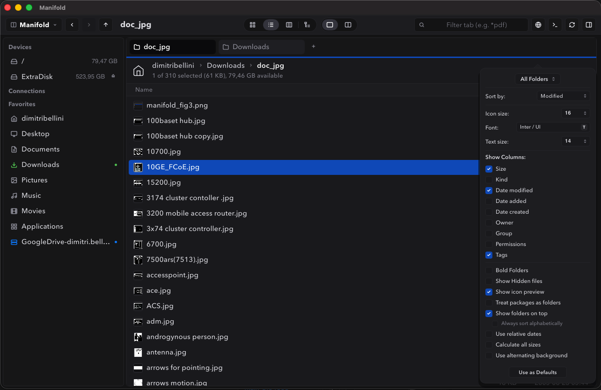

# Manifold

<div align="center">

[](https://github.com/dimitribellini/manifold)
[](https://github.com/dimitribellini/manifold/releases)
[](#quick-start)
[](#architecture)
[](#license)

Cross-platform dual-pane file manager and remote transfer client built in Rust and Slint.

[**Releases**](https://github.com/dimitribellini/manifold/releases) · [**Quick Start**](#quick-start) · [**Features**](#features) · [**Remote Connections**](#remote-connections) · [**Keyboard Shortcuts**](#keyboard-shortcuts) · [**Build from Source**](#build-from-source) · [**Architecture**](#architecture)

</div>

---

<div align="center">
  
</div>

---

## Quick Start

Download the latest release for **macOS (Apple Silicon)**, **Linux (x86_64)**, or **Windows (x86_64)** from [GitHub Releases](https://github.com/dimitribellini/manifold/releases).

### macOS (Apple Silicon / ARM64)
```bash
curl -sSL https://github.com/dimitribellini/manifold/releases/latest/download/manifold-macos-arm64.tar.gz | tar -xz
mv Manifold.app /Applications/
open /Applications/Manifold.app
```

### Linux (x86_64)
```bash
curl -sSL https://github.com/dimitribellini/manifold/releases/latest/download/manifold-linux-x86_64.tar.gz | tar -xz
chmod +x manifold-linux-x86_64
sudo mv manifold-linux-x86_64 /usr/local/bin/manifold
manifold
```

### Windows (x86_64)
```powershell
Invoke-WebRequest -Uri https://github.com/dimitribellini/manifold/releases/latest/download/manifold-windows-x86_64.zip -OutFile manifold-windows-x86_64.zip
Expand-Archive -Path manifold-windows-x86_64.zip -DestinationPath .
.\Manifold.exe
```

---

## Features

- **Single & Dual-Pane Layout**: Switch between single and dual panes (`Cmd/Ctrl + Alt + T`) with multiple tabs per pane and automatic session restore.
- **Four View Modes**: Browse files as **Icons**, **List**, **Columns** (Miller view), or **Tree** (`Cmd/Ctrl + 1..4`).
- **Recursive Search**: Filter the current folder and subfolders using wildcards (`*`, `?`), and jump to any result's parent folder with **Show in Enclosing Folder**.
- **Inspector & Quick Look**: Inspect file metadata, media details, color tags, and `R/W/X` permissions (`Cmd/Ctrl + I`), or preview files with `Space`.
- **Built-in Terminal**: Integrated terminal drawer (`>_`) running your local shell (`zsh`, `bash`, `PowerShell`) or an interactive remote `ssh` session when browsing SFTP servers.
- **Archives & Packages**: Create `.zip` and `.tar.gz` archives, browse archive contents in place, or extract `.zip`, `.tar.*`, `.7z`, and `.rar` files.
- **File Transfers & Sync**: Background copy/move with conflict resolution (`Replace`, `Replace Older`, `Keep Both`, `Skip`), directory comparison/sync, and batch rename.
- **Themes & Fonts**: Six built-in color themes and adjustable UI font family, size, and weight (`Cmd/Ctrl + ,`).

### Folder View Options (`Cmd/Ctrl + J`)

<div align="center">
  
</div>

- **Scope & Inheritance**: Apply view settings to **All Folders**, **This Folder**, or **This Folder and Subfolders**, and save any layout with **Use as Defaults**.
- **Sorting & Sizing**: Choose the default sort field (`Name`, `Modified`, `Created`, `Added`, `Size`, `Kind`), row icon size (`16px` / `20px` / `24px`), and text size (`11px`–`16px`).
- **Customizable Columns**: Show or hide `Size`, `Kind`, `Date Modified`, `Date Added`, `Date Created`, `Owner`, `Group`, `Permissions`, and `Tags`.
- **Display Preferences**: Toggle **Bold Folders**, **Show Hidden Files**, **Show Icon Preview**, **Treat Packages as Folders**, **Show Folders on Top**, **Use Relative Dates**, **Calculate All Sizes**, and **Use Alternating Background**.

---

## Remote Connections

<div align="center">
  
</div>

- **Supported Protocols**: `SFTP / SSH` (password or SSH key), `Amazon S3` (and S3-compatible endpoints), `SMB`, `FTP / FTPS`, and `WebDAV`.
- **Automatic Terminal Sync**: Opening an SFTP connection switches the bottom terminal to a live `ssh` session in the active remote folder.
- **Mounted Shares**: Active Linux `NFS`, `SMB / CIFS`, and `SSHFS` mounts appear automatically in the `Connections` sidebar.
- **Keychain Integration**: Passwords and key passphrases are stored in the OS keyring (`macOS Keychain`, Linux `libsecret`, or `Windows Credential Manager`).

---

## Keyboard Shortcuts

| Shortcut | Action |
| :--- | :--- |
| `Up` / `Down` / `PageUp` / `PageDown` / `Home` / `End` | Move selection (`Shift` extends selection) |
| `Right` / `Enter` | Open selected folder or file (`Right` expands folder in `Tree` view) |
| `Left` / `Backspace` | Go to parent directory (`Left` collapses folder in `Tree` view) |
| `Cmd/Ctrl + 1..4` | Switch view mode (`1` Icons, `2` List, `3` Columns, `4` Tree) |
| `ESC` | Clear active input or close active menu, modal, or terminal drawer |
| `Space` | Toggle Quick Look preview for selected item |
| `Cmd/Ctrl + F` | Focus per-tab search/filter box |
| `Cmd/Ctrl + L` | Toggle path bar edit mode (`Tab` auto-complete) |
| `Cmd/Ctrl + T` | Open selected folder in a new tab |
| `Cmd/Ctrl + A` | Select all items in active pane |
| `Cmd/Ctrl + C` / `X` / `V` | Copy / Cut / Paste selected items |
| `Cmd/Ctrl + D` | Duplicate selected items |
| `Cmd/Ctrl + N` | Create new folder |
| `Cmd/Ctrl + R`, `F2`, or click selected name | Rename selected item |
| `Cmd/Ctrl + Shift + C` | Copy full path or URI to clipboard |
| `Cmd/Ctrl + I` | Toggle Inspector drawer (`Info` / `Tasks`) |
| `Cmd/Ctrl + J` | Toggle File & Directory View Options (`Show View Options`) |
| `Cmd/Ctrl + ,` | Open Preferences modal |
| `Delete` | Move selected items to Trash |
| `Shift + Delete` | Permanently delete selected items |
| `Alt + Left` / `Alt + Right` | Navigate Back / Forward in tab history |
| `Alt + Up` | Navigate to enclosing folder |

---

## Build from Source

### Prerequisites
- **Rust**: Stable toolchain (`1.80+`, 2021 edition)
- **Linux dependencies**:
  ```bash
  sudo apt-get install -y build-essential pkg-config cmake ninja-build clang \
    libssl-dev libdbus-1-dev libfontconfig1-dev libfreetype6-dev \
    libx11-dev libxcb1-dev libxkbcommon-dev libwayland-dev libgl1-mesa-dev
  ```

### Compile & Run
```bash
git clone https://github.com/dimitribellini/manifold.git
cd manifold

# Run in release mode
cargo run --release --bin manifold

# Run unit tests
cargo test --workspace --lib
```

---

## Architecture

```text
manifold/
├── crates/
│   ├── vfs/          # Local filesystem backend, permissions matrix, and archive reader
│   ├── vfs-remote/   # Remote backends (SFTP, S3, SMB, FTP, WebDAV) and streaming transfers
│   ├── config/       # Connection profiles, user preferences, and OS keyring integration
│   ├── transfer/     # Transfer queue, bandwidth limiter, and conflict resolution models
│   ├── sync/         # Directory comparison/sync engine and batch rename rules
│   ├── preview/      # File metadata, permissions inspector, and text/hex preview formatters
│   └── ui/           # Slint desktop interface, PTY terminal integration, and theme state
└── src/
    └── main.rs       # Application entrypoint
```

---

## License

Released under the [MIT License](LICENSE).
