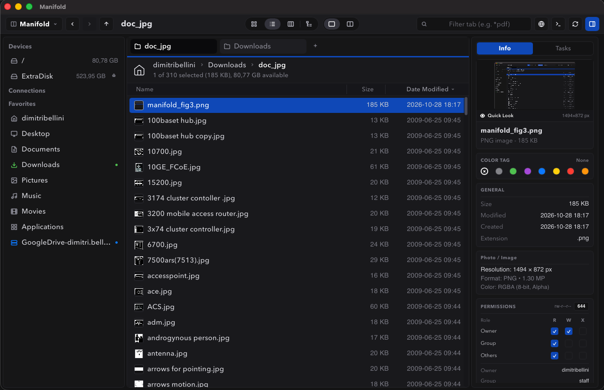
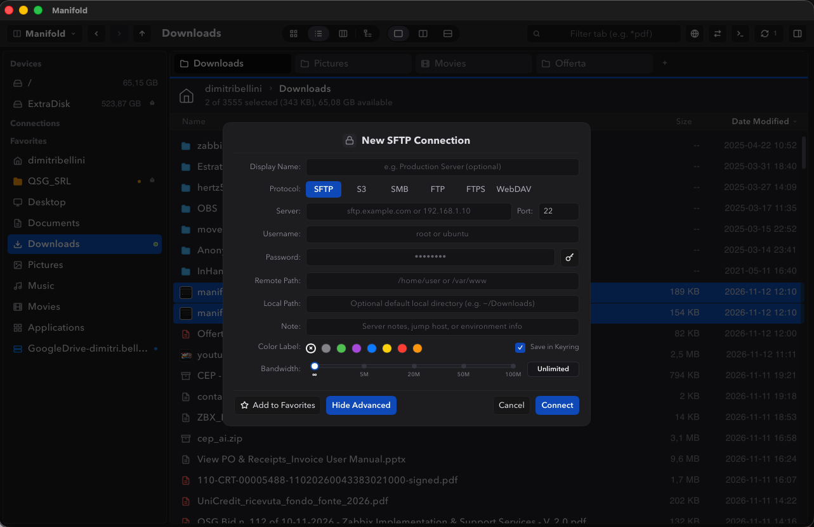

# Manifold

<div align="center">

[](https://github.com/dimitribellini/manifold)
[](https://github.com/dimitribellini/manifold/releases)
[](#quick-start)
[](#architecture)
[](#license)

Cross-platform dual-pane file manager and remote transfer client built in Rust and Slint.

[**Releases**](https://github.com/dimitribellini/manifold/releases) · [**Quick Start**](#quick-start) · [**Features**](#features) · [**Remote Connections**](#remote-connections) · [**Keyboard Shortcuts**](#keyboard-shortcuts) · [**Build from Source**](#build-from-source) · [**Architecture**](#architecture)

</div>

---

<div align="center">
  
</div>

---

## Quick Start

Download the latest release for **macOS (Apple Silicon)**, **Linux (x86_64)**, or **Windows (x86_64)** from [GitHub Releases](https://github.com/dimitribellini/manifold/releases).

### macOS (Apple Silicon / ARM64)
```bash
curl -sSL https://github.com/dimitribellini/manifold/releases/latest/download/manifold-macos-arm64.tar.gz | tar -xz
mv Manifold.app /Applications/
open /Applications/Manifold.app
```

### Linux (x86_64)
```bash
curl -sSL https://github.com/dimitribellini/manifold/releases/latest/download/manifold-linux-x86_64.tar.gz | tar -xz
chmod +x manifold-linux-x86_64
sudo mv manifold-linux-x86_64 /usr/local/bin/manifold
manifold
```

### Windows (x86_64)
```powershell
Invoke-WebRequest -Uri https://github.com/dimitribellini/manifold/releases/latest/download/manifold-windows-x86_64.zip -OutFile manifold-windows-x86_64.zip
Expand-Archive -Path manifold-windows-x86_64.zip -DestinationPath .
.\Manifold.exe
```

---

## Features

- **Single & Dual-Pane Workspace**: Switch between Single Pane and Dual Pane via the 2-icon toolbar pill switcher (`Cmd/Ctrl + Alt + T`) with resizable splitters, live external directory change detection, and automatic session restore (`session.toml`) for open tabs, view modes, sort order, and panel dimensions.
- **Tabs, Favorites & Breadcrumbs**: Multiple tabs per pane, animated drag-and-drop reordering for tabs and sidebar `Favorites`, clickable breadcrumb navigation with sibling folder dropdowns, and `Cmd/Ctrl + L` path editing with `Tab` completion.
- **View Modes (`Icons`, `List`, `Columns`, `Tree`)**: Responsive 4-icon toolbar pill switcher (`Cmd/Ctrl + 1..4`) supporting a 3-column icon grid with cached image thumbnails, a flat sortable details table (`Name | Size | Date Modified` with directories grouped above files), Miller columns with inline media metadata, and a hierarchical expandable directory tree (`Tree` view with disclosure chevrons, tree guide lines, and `Left`/`Right` arrow expansion/collapse).
- **Recursive Search**: Non-blocking Breadth-First Search across downstream subdirectories (local and remote SFTP) with wildcard (`*`, `?`) and multi-token matching, relative parent path display in `List` view, clickable `Search: "<query>"` header pill to clear the filter, and `Show in Enclosing Folder` in the context menu when a search match is located in a subfolder.
- **Inspector & Previews**: Right-hand Inspector drawer (`Cmd/Ctrl + I`) for file metadata, photo/audio/video details, persistent 8-color tags, and `R/W/X` (`Octal`) permissions, plus Quick Look (`Space`) and hover previews for images, text, code, and documents.
- **Background Transfers & Conflict Resolution**: Non-blocking local and remote file operations with progress tracking, bandwidth limiting, and pre-flight conflict resolution (`Replace`, `Replace Older`, `Keep Both`, `Skip`, `Stop`, with `Apply to all`).
- **Integrated Terminal (Local & Remote SSH)**: Built-in VT100/Xterm terminal emulator (`>_`) with cell-aligned monospace rendering (`Menlo`, `Consolas`, `DejaVu Sans Mono`), 256/TrueColor SGR support, DEC box-drawing, 1,000-line scrollback, and alternate screen buffer (`top`, `htop`, `less`, `vim`). Runs a native POSIX PTY shell (`zsh`/`bash`) on macOS/Linux and ConPTY PowerShell (`pwsh`/`powershell`) on Windows, and automatically opens an interactive remote `ssh` PTY session when browsing a remote SFTP connection.
- **Drag-and-Drop & Clipboard**: Drag-and-drop across panes, folder rows, tabs, breadcrumbs, sidebar items, and external OS applications (native `NSDraggingSession` on macOS and OS file clipboard integration).
- **Archives, macOS Bundles, Open With, Sync & Batch Rename**: Create `.tar.gz` or `.zip` archives from single or multiple items, inspect archive contents directly via `Show Archive Contents`, extract `.zip`, `.tar.gz`, `.tar.bz2`, `.tar.xz`, `.tar`, `.7z`, `.rar`, `.gz`, `.bz2`, and `.xz` archives in place (unwrapping single `.app` bundles on macOS, preserving bundle signatures and stripping download quarantine attributes when extracting or copying `.app` bundles to `/Applications`, and treating `.app` directories as native Application packages with `Show Package Contents`), open files with external applications (`Open With…`), compare/sync directories, and batch-rename files.
- **Themes & Typography**: Configurable font family, size, weight, and 6 color themes (`Cmd/Ctrl + ,`) persisted in `preferences.toml`.

---

## Remote Connections

<div align="center">
  
</div>

- **Protocols**: `SFTP / SSH` (password or private key), `Amazon S3` (and S3-compatible storage), `SMB`, `FTP / FTPS`, and `WebDAV`.
- **Interactive Remote Shell**: Selecting a remote SFTP connection synchronizes the bottom terminal drawer to an authenticated `ssh` PTY session in the active remote directory.
- **Linux Network Mounts**: Active `NFS`, `CIFS / SMB`, and `SSHFS` mounts from `/proc/mounts` are automatically listed in the `Connections` sidebar with unmount/eject support.
- **Streaming I/O**: Remote file transfers stream directly between disk and `scp`/remote storage without buffering full files in memory.
- **OS Keychain Storage**: Connection profiles are stored in `connections.toml`, while passwords and keys are stored in the native OS keyring (`macOS Keychain`, Linux `libsecret`, or Windows Credential Manager).

---

## Keyboard Shortcuts

| Shortcut | Action |
| :--- | :--- |
| `Up` / `Down` / `PageUp` / `PageDown` / `Home` / `End` | Move selection (`Shift` extends selection) |
| `Right` / `Enter` | Open selected folder or file (`Right` expands folder in `Tree` view) |
| `Left` / `Backspace` | Go to parent directory (`Left` collapses folder in `Tree` view) |
| `Cmd/Ctrl + 1..4` | Switch view mode (`1` Icons, `2` List, `3` Columns, `4` Tree) |
| `ESC` | Clear active input or close active menu, modal, or terminal drawer |
| `Space` | Toggle Quick Look preview for selected item |
| `Cmd/Ctrl + F` | Focus per-tab search/filter box |
| `Cmd/Ctrl + L` | Toggle path bar edit mode (`Tab` auto-complete) |
| `Cmd/Ctrl + T` | Open selected folder in a new tab |
| `Cmd/Ctrl + A` | Select all items in active pane |
| `Cmd/Ctrl + C` / `X` / `V` | Copy / Cut / Paste selected items |
| `Cmd/Ctrl + D` | Duplicate selected items |
| `Cmd/Ctrl + N` | Create new folder |
| `Cmd/Ctrl + R`, `F2`, or click selected name | Rename selected item |
| `Cmd/Ctrl + Shift + C` | Copy full path or URI to clipboard |
| `Cmd/Ctrl + I` | Toggle Inspector drawer (`Info` / `Tasks`) |
| `Cmd/Ctrl + ,` | Open Preferences modal |
| `Delete` | Move selected items to Trash |
| `Shift + Delete` | Permanently delete selected items |
| `Alt + Left` / `Alt + Right` | Navigate Back / Forward in tab history |
| `Alt + Up` | Navigate to enclosing folder |

---

## Build from Source

### Prerequisites
- **Rust**: Stable toolchain (`1.80+`, 2021 edition)
- **Linux dependencies**:
  ```bash
  sudo apt-get install -y build-essential pkg-config cmake ninja-build clang \
    libssl-dev libdbus-1-dev libfontconfig1-dev libfreetype6-dev \
    libx11-dev libxcb1-dev libxkbcommon-dev libwayland-dev libgl1-mesa-dev
  ```

### Compile & Run
```bash
git clone https://github.com/dimitribellini/manifold.git
cd manifold

# Run in release mode
cargo run --release --bin manifold

# Run unit tests
cargo test --workspace --lib
```

---

## Architecture

```text
manifold/
├── crates/
│   ├── vfs/          # Local filesystem backend, permissions matrix, and archive reader
│   ├── vfs-remote/   # Remote backends (SFTP, S3, SMB, FTP, WebDAV) and streaming transfers
│   ├── config/       # Connection profiles, user preferences, and OS keyring integration
│   ├── transfer/     # Transfer queue, bandwidth limiter, and conflict resolution models
│   ├── sync/         # Directory comparison/sync engine and batch rename rules
│   ├── preview/      # File metadata, permissions inspector, and text/hex preview formatters
│   └── ui/           # Slint desktop interface, PTY terminal integration, and theme state
└── src/
    └── main.rs       # Application entrypoint
```

---

## License

Released under the [MIT License](LICENSE).
